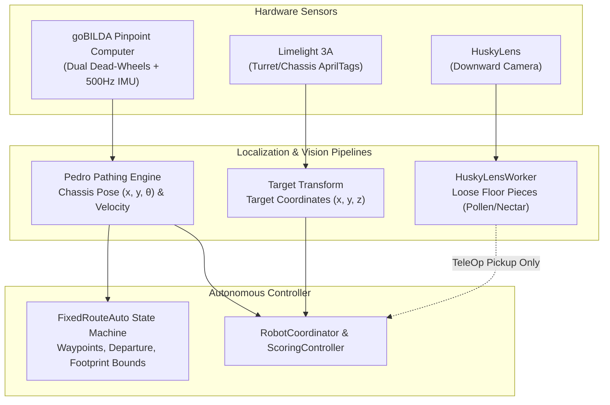

# BIOBUZZ Worlds Domination Technical Audit & Action Plan

## 1. Executive Summary

To transition from a competitive FTC robot to a **Worlds Champion that dominates the division**, the software and control system must eliminate all human and latency bottlenecks. 

Currently, the robot's code architecture possesses advanced foundations (time-travel exposure interpolation, 24-step iterative kinematic lead solving, and Pinpoint odometry fusion). However, several key interlocks, architectural assumptions, and conservative parameters hold the robot back from achieving maximum cycle throughput:
1. **Auto Navigation Confusion**: Auto does **NOT** use the HuskyLens. Auto uses the **goBILDA Pinpoint Odometry Computer** and **Pedro Pathing**. The HuskyLens is dedicated exclusively to carpet piece detection.
2. **Shoot-While-Moving Bottleneck**: The solver (`MotionShotSolver`) is mathematically sound, but requires continuous live AprilTag sightlines (`targetFresh`). Fast rotations and strafing drop the target, zeroing the solution and inhibiting the feed.
3. **Autonomous Throughput (5-Tip Auto)**: The current autonomous routine contains only a single waypoint (`1 shot`). Achieving 5 tips in 30 seconds requires a strict 5.5-second cycle time budget, non-stopping waypoints, continuous flywheel pre-spin, and shooting on the fly without waiting for HIVE settlement.

---

## 2. How Autonomous Actually Knows Where to Go



### Clarifying the Sensors' True Roles:
- **goBILDA Pinpoint Odometry Computer + Pedro Pathing**: **Controls Auto Navigation**.
  - Reads dual perpendicular tracking wheels (dead-wheels) plus a dedicated high-frequency IMU directly on a separate processor.
  - Updates at ~500Hz, completely immune to camera frame rate drops, motion blur, or field lighting changes.
  - `FixedRouteAuto` evaluates its position $(x, y, \theta)$ exclusively against Pedro's Pinpoint-fused state.
- **Limelight 3A**: **Controls Turret Target Aiming**.
  - Detects AprilTags / retroreflective targets on the HIVE structure.
  - Computes target field position $(x, y, z)$ via `CameraTargetTransform` using time-travel historical pose interpolation (`RobotStateHistory.sampleAt(exposureSec)`).
- **HuskyLens**: **Does NOT Guide Auto Waypoints**.
  - Mounted pointing down at the carpet.
  - Exclusively performs color classification of pollen/nectar pieces on the floor for dynamic piece pickup assist (`PickupAssist` / `PieceTracker`).

---

## 3. Shoot-While-Moving: Current State & Dominating Upgrades

### How It Works Right Now
In [`MotionShotSolver.java`](file:///c:/Users/sbots/StudioProjects/ftcrobotcontroller/TeamCode/src/main/java/org/firstinspires/ftc/teamcode/scoring/MotionShotSolver.java), the robot solves:
$$\vec{D}_{equivalent} = \vec{P}_{target} - \vec{P}_{muzzle}(t_{release}) - \vec{V}_{muzzle}(t_{release}) \cdot t_{flight}$$
Where $\vec{V}_{muzzle}$ combines:
1. Chassis translational velocity $(v_x, v_y)$
2. Pivot rotational velocity $\vec{\omega}_{chassis} \times \vec{r}_{pivot}$
3. Turret rotational slew rate $(\vec{\omega}_{chassis} + \dot{\theta}_{turret}) \times \vec{r}_{muzzle}$

The solver iterates up to 24 times to find the exact intersection of projectile flight time and muzzle lead angle.

### Why It Fails in Fast Driving (The Worlds Bottlenecks)
1. **Optical Sightline Dependency (`targetFresh`)**:
   - If the robot turns sharply, the Limelight loses sight of the AprilTag. `targetFresh` instantly becomes `false`.
   - In [`RobotCoordinator.java`](file:///c:/Users/sbots/StudioProjects/ftcrobotcontroller/TeamCode/src/main/java/org/firstinspires/ftc/teamcode/robot/RobotCoordinator.java), when `targetFresh == false`, `aim` is null, `shotSolution` is null, and the turret immediately resets.
   - **Fix**: **Field-Centric Persistent Target Lock**. The HIVE has fixed field coordinates. Once confirmed by Limelight, the turret should aim at the known HIVE field coordinates using Pinpoint odometry even if the tag is blocked or out of the camera's FOV.
2. **Turret Lag (Missing Velocity Feedforward)**:
   - When the robot strafes past the HIVE at 60 in/s, the angle to the HIVE rotates at up to 1.5 rad/s.
   - Pure position feedback PID lags behind the rotating bearing, causing `aimError > aimTolerance` (1.5°), withholding the trigger.
   - **Fix**: Add dynamic feedforward to the turret controller: $\dot{\theta}_{ff} = \omega_{orbit} - \omega_{chassis}$.
3. **Conservative Miss Bound Gating**:
   - In `RobotCoordinator`:
     ```java
     double allowedMiss = snapshot.target.internalPoint ? Math.min(movingShots.settings.maxMissInches, snapshot.target.lipClearance) : movingShots.settings.maxMissInches;
     ```
     If `maxMissInches` is set to 3.0" while the goal aperture is 8.0", small estimated uncertainties inhibit firing when the shot would easily score.

---

## 4. The 5-Tip Autonomous Strategy (30-Second Time Budget)

To achieve 5 tips during the 30-second autonomous period, cycle times must be hyper-optimized:

| Phase | Action | Leg Time | Total Time | Notes |
| :--- | :--- | :--- | :--- | :--- |
| **Start** | Instant Preload Launch | 0.8s | 0.8s | Pre-spinned flywheel, zero delay |
| **Tip 1** | Drive to Spike 1 + Intake 2 balls | 2.5s | 3.3s | Intake running during transit |
| **Shoot 1** | Shoot-on-the-fly (2 balls) | 1.2s | 4.5s | **Tip #1 scored**; no stop at scoring pose |
| **Tip 2** | Drive to Spike 2 + Intake 2 balls | 2.5s | 7.0s | Dismiss HIVE wait; do not wait for settle |
| **Shoot 2** | Shoot-on-the-fly (2 balls) | 1.2s | 8.2s | **Tip #2 scored** |
| **Tip 3** | Drive to Floor Cluster + Intake 2 balls | 2.6s | 10.8s | Continuous high-speed Pedro path |
| **Shoot 3** | Shoot-on-the-fly (2 balls) | 1.2s | 12.0s | **Tip #3 scored** |
| **Tip 4** | Drive to Submersible/Neutral Stack | 2.8s | 14.8s | Intake deployed at arrival |
| **Shoot 4** | Shoot-on-the-fly (2 balls) | 1.2s | 16.0s | **Tip #4 scored** |
| **Tip 5** | Drive to Final Floor Stack | 2.8s | 18.8s | Rapid intake sweep |
| **Shoot 5** | Final Moving Burst (2 balls) | 1.2s | 20.0s | **Tip #5 scored** |
| **Park** | Navigate to Ascent/Park Zone | 2.5s | 22.5s | Park confirmed safely before 30s deadline |
| **Margin** | Buffer for defense / field variation | 7.5s | 30.0s | Critical safety margin |

### Key Code Enablers for 5-Tip Auto:
1. **Never Stop to Shoot**: Waypoints in `FixedRouteAuto` must have `shoot = true` without setting velocity to zero; the robot strafes past the scoring zone while the turret aims and unloads.
2. **`dismissWait = true`**: After confirmed exit, immediately dismiss `WAIT_FOR_HIVE`. The robot departs for the next intake run while the previous ball is still in the air.
3. **Concurrent Intake & Drive**: Pre-start intake rollers 0.3s before reaching the balls so balls are sucked in instantaneously upon contact.

---

## 5. Architectural Upgrades to Dominate at Worlds

### A. Drivetrain & Pathing
- **Pedro Bezier Spline Curves**: Replace discrete point-to-point waypoints in `FixedRouteAuto` with continuous tangential Bezier curves (`PathChain`) so the chassis never halts at corners.
- **Maximum Acceleration Limits**: Tune motor current limits and feedforward in `PedroConstants` to hit 70+ in/s without traction slip.

### B. Turret & Targeting
- **Odometry HIVE Lock with AprilTag EKF**:
  Store the HIVE center as a global field coordinate. When Limelight sees a tag, perform an Extended Kalman Filter (EKF) update to correct odometry drift. When the tag is out of view, maintain turret lock based purely on the Pinpoint robot pose.
- **Centripetal Aim Feedforward**: Calculate required turret angular rate $\dot{\theta} = \frac{\vec{V}_{rel} \times \vec{r}}{|\vec{r}|^2}$ directly into the servo/motor drive.

### C. Launcher & Feeder Throughput
- **Zero-Latency Staging**: As soon as a ball leaves the stage sensor, the transfer motor immediately feeds the next ball to the staging beam-break without waiting for operator command.
- **Flywheel Active Speed Compensation**: Read battery bus voltage drop during motor spin-up and apply active feedforward compensation to prevent RPM dips on consecutive rapid shots.

### D. Single-Driver Ergonomics
- The single-driver PS5 controls now implemented (holding L2 for precision, R1 tap/hold for single/burst, and automatic flywheel pre-spin) drastically lower driver cognitive load, freeing the driver to focus 100% on field awareness, defense evasion, and cycles.
